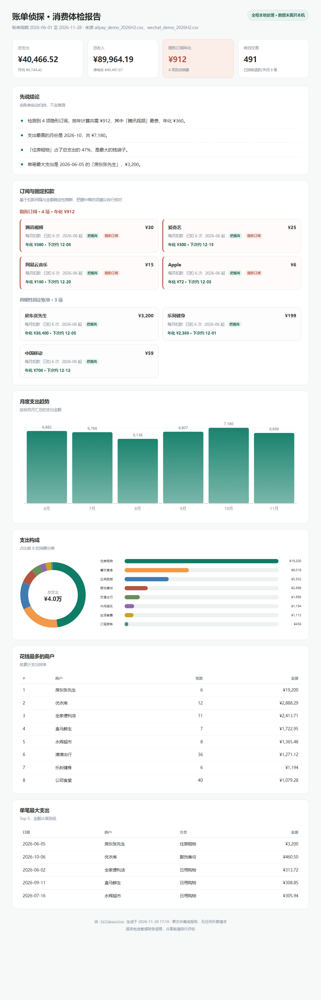

# BillDetective

**Find the money quietly leaving your account — on your own machine.**

Import an Alipay or WeChat Pay statement (CSV) and get a clear report of what you actually spend, including the subscriptions that renew without you noticing.

Zero dependencies · Fully offline · Single-file report · Your data never leaves your computer



> The interface and report are in Simplified Chinese, since the supported statements are. The codebase, docstrings and this README are in English.

## The problem

Streaming trials that silently convert to paid plans. Cloud storage, music, a gym you forgot about. A "how much do I actually spend?" question that takes an evening of spreadsheet work. And most expense apps want you to sign in and upload your statements to their servers.

BillDetective does one thing: **give it a statement CSV, and it tells you which money is leaking.**

## Quick start

```bash
git clone https://github.com/wqeadsfdghd/billdetective.git
cd billdetective

# Try it on the bundled synthetic data first
python -m billdetective examples/alipay_demo_2026H2.csv examples/wechat_demo_2026H2.csv --open

# Then on your own statements
python -m billdetective alipay.csv wechat.csv --out report.html
```

Output formats:

```bash
python -m billdetective statement.csv                  # HTML report (default)
python -m billdetective statement.csv --format text    # terminal summary
python -m billdetective statement.csv --format json    # structured data
```

Requires Python 3.10+. **Nothing to `pip install`.**

## How subscription detection works

The naive rule — "same merchant, ~30 days apart" — mislabels your weekly noodle shop as a weekly plan and your monthly card repayment as a subscription. One false positive and users stop trusting the tool.

So detection must pass four gates:

1. **Cycle fitting.** Candidate cycles (monthly / quarterly / yearly) must explain *every* gap, allowing one missed charge. Irregular gaps fail.
2. **Amount stability.** Subscription prices barely move; discretionary spending does. Coefficient of variation must stay low.
3. **Category gating.** Food, transport and daily-goods merchants are excluded unless the name explicitly says membership/plan.
4. **Weekly is refused.** Weekly cadence cannot be separated from habit spending using statement data alone.

Two structural traps are handled separately: **internal transfers** (credit-card repayment, wallet top-ups, withdrawals) are demoted to neutral so card spending is not double-counted, and **refunded or closed orders** are excluded outright.

Full rationale: [docs/design.md](docs/design.md).

## Privacy

No network calls, no telemetry, no account. The only file access is the statements you pass in. The report states "processed locally" because there is genuinely no HTTP client in the codebase.

## Project layout

```
src/billdetective/
├── models.py          Normalised transaction model
├── parsers/           Alipay / WeChat / generic CSV, with encoding + header auto-detection
├── categorize.py      Category rules and internal-transfer detection
├── subscriptions.py   Recurring-charge detection (the core algorithm)
├── analyze.py         Aggregation and insight generation
├── report/            HTML and terminal renderers, hand-rolled inline SVG charts
└── cli.py             Command line entry point
tests/                 51 unit tests
examples/              Synthetic statements + generator
docs/                  Design notes
```

## Development

```bash
PYTHONPATH=src python -m unittest discover -s tests -v
python examples/generate_demo.py
```

## License

[MIT](LICENSE)
