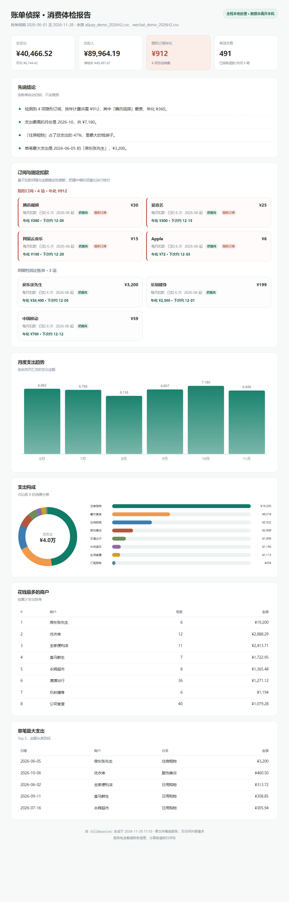

# 账单侦探 · BillDetective

**在你自己电脑上，找出偷偷流走的钱。**

导入支付宝 / 微信账单 CSV，自动揪出「自动续费」这类无感扣款，并给你一份能看懂、能分享的消费体检报告。

零依赖 · 纯本地 · 单文件报告 · 数据永不出本机



---

## 它解决什么问题

你可能也遇到过：

- 视频会员首月 6 元，第二个月静悄悄扣了 25 元，扣了半年你才发现；
- 云存储、音乐、健身房、某个早就忘记的 App，加起来一年小一千；
- 想算算「我一个月到底花多少」，翻账单翻到眼花；
- 市面上记账 App 要么要求授权登录、要么上传账单到云端。

账单侦探只做一件事：**把账单 CSV 喂给它，把「哪些钱在悄悄流走」还给你**。

它不上传任何东西、不要求注册、不联网。整个工具是一个 Python 包，零第三方依赖，`git clone` 之后直接就能跑。

## 30 秒上手

```bash
git clone https://github.com/wqeadsfdghd/billdetective.git
cd billdetective

# 用自带的合成示例数据先跑一遍（不含任何真实信息）
python -m billdetective examples/alipay_demo_2026H2.csv examples/wechat_demo_2026H2.csv --open
```

浏览器会打开一份报告。看完示例，把路径换成你自己的账单即可：

```bash
python -m billdetective 支付宝账单.csv 微信账单.csv --out 我的报告.html
```

三种输出格式：

```bash
python -m billdetective 账单.csv                  # HTML 报告（默认）
python -m billdetective 账单.csv --format text    # 终端速览
python -m billdetective 账单.csv --format json    # 结构化数据，接你自己的分析
```

> 需要 Python 3.10+。**不需要** `pip install` 任何东西。

## 怎么导出账单

**支付宝**：App → 我的 → 账单 → 右上角「…」→ 开具交易流水证明 → 选择时间范围 → 导出为 CSV（会发到邮箱）。

**微信**：App → 我 → 服务 → 钱包 → 账单 → 常见问题 → 下载账单 → 用于个人对账 → 选择时间范围 → 导出 CSV（邮箱收到后解压，密码在微信里）。

两个文件可以**一起喂**给它。跨平台合并时，同一天、同金额、同商户的记录会自动去重，不会重复计算。

## 报告里有什么

| 板块 | 内容 |
|---|---|
| 关键指标 | 总支出、总收入、净结余、**隐形订阅年化** |
| 先说结论 | 自动归纳的 4–5 句话，不含推测 |
| 订阅与固定扣款 | 分成「隐形订阅」和「固定账单」两组，标注扣款周期、已扣次数、年化成本、下次预计扣款日 |
| 月度趋势 | 逐月支出柱状图 |
| 支出构成 | 分类占比环形图 + 条形图 |
| 花钱最多的商户 | Top 8 |
| 单笔最大支出 | Top 5 |

报告是**单个 HTML 文件**，CSS 和图表（手绘 SVG）全部内联。可以双击打开、可以断网看、可以直接发给朋友 —— 而账单本身始终留在你电脑上。

## 它是怎么判断「订阅」的

这是整个项目最需要克制的地方。随便一个「同商户、间隔 30 天」的规则，就会把「每周吃一次的兰州拉面」判成周订阅，把「每月还信用卡」判成月订阅。一旦报错，用户就再也不信这个工具了。

所以检测要过四道关：

1. **周期拟合** — 月付 / 季付 / 年付三档候选周期，必须能解释*每一个*扣款间隔。允许一次漏扣（间隔跨 1–3 个周期），但不允许间隔忽长忽短。
2. **金额稳定性** — 订阅价格几乎不变，随手消费不会。金额变异系数必须足够小。
3. **类别门控** — 餐饮、交通、日用这类高频习惯消费，除非商户名里明确写着「会员/订阅」，否则一律不参与判定。
4. **拒绝周付** — 周级节奏在账单数据里和「习惯性消费」无法区分，宁可不报，也不误报。

另外两类结构性干扰被单独处理：

- **内部转账不计支出** — 信用卡还款、转入余额宝、提现，这些是把钱从左口袋挪到右口袋。计入就会重复计算整张信用卡的消费。
- **退款 / 关闭交易不计支出** — 状态为「退款成功」「交易关闭」的行直接排除。

算法细节和取舍理由见 [docs/design.md](docs/design.md)。

## 隐私

- 没有网络请求，没有遥测，没有账号；
- 不读写账单以外的任何文件；
- 报告里的「全程本地处理」不是营销话术 —— 代码里没有任何 `http` 客户端。

唯一的例外是 `--open` 参数会调用系统默认浏览器打开本地文件。

## 项目结构

```
src/billdetective/
├── models.py          统一数据模型（金额 / 方向 / 退款状态）
├── parsers/           支付宝、微信、通用 CSV 解析（编码与表头自动探测）
├── categorize.py      分类规则 + 内部转账识别
├── subscriptions.py   隐形订阅检测（核心算法）
├── analyze.py         聚合与洞察生成
├── report/            HTML / 终端报告，手绘 SVG 图表
└── cli.py             命令行入口
tests/                 51 个单元测试
examples/              合成示例账单 + 生成脚本
docs/                  设计文档
```

## 开发

```bash
# 跑测试（同样零依赖）
PYTHONPATH=src python -m unittest discover -s tests -v

# 重新生成示例数据
python examples/generate_demo.py
```

欢迎提 Issue 和 PR。特别是：**更多银行的账单格式**、**更多订阅商户的识别规则**、**分类关键词补充**。如果这个工具在你自己的账单上报错了，请把那几条（脱敏后的）记录贴到 Issue 里 —— 误报样本比任何功能建议都有价值。

## 路线图

- [ ] 银行 App / 信用卡账单格式
- [ ] 「订阅涨价」检测（同一订阅价格上调）
- [ ] 已停用但仍可能扣费的订阅提醒
- [ ] 年度对比报告
- [ ] 完全离线的浏览器版（账单不出浏览器）

## 许可

[MIT](LICENSE)
